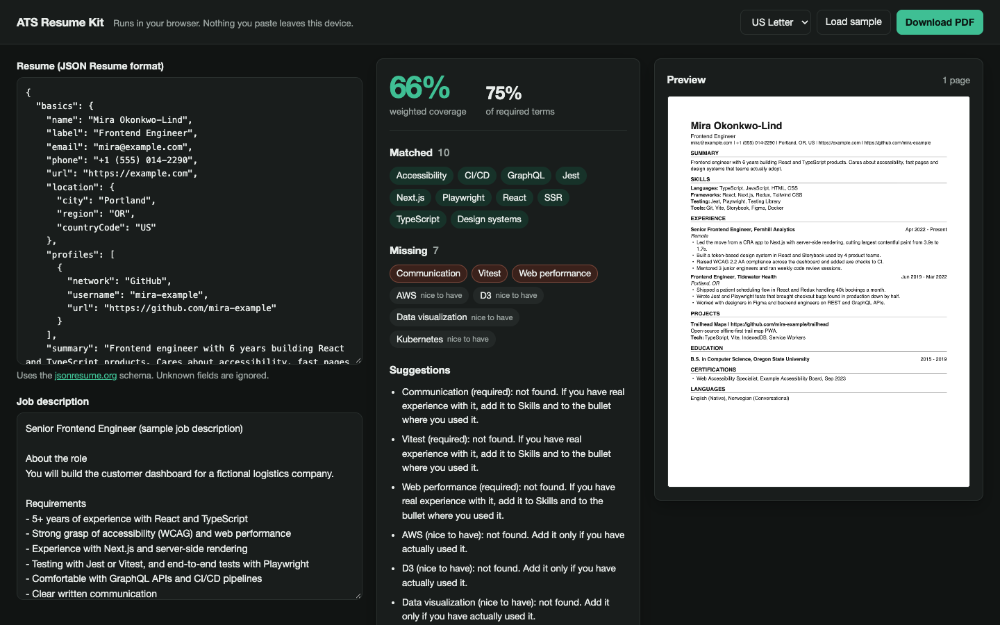
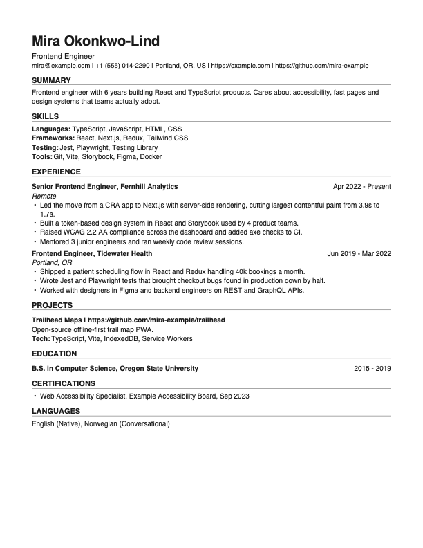
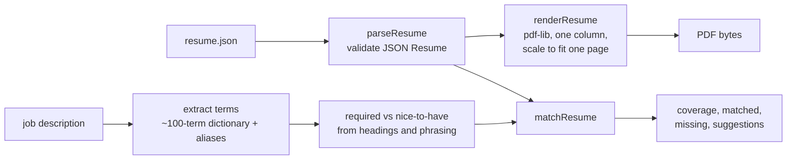

# ats-resume-kit

Turn a [JSON Resume](https://jsonresume.org/schema) into a clean one-page PDF that applicant tracking systems can parse, and check how well it covers a job description.

[](LICENSE)
[](tsconfig.json)
[](test)
[](package.json)


| Dark mode | Phone | Generated PDF |
| --- | --- | --- |
|  |  |  |

The sample resume (`examples/resume.json`) and job (`examples/job.txt`) are fictional.

## Features

- **Library + CLI** (TypeScript): `renderResume()` and `matchResume()`, or `ats-resume render` / `ats-resume match`.
- **ATS-safe PDF**: one column, real text in a standard font, standard headings, one page (type scales down to fit).
- **Keyword matcher**: pulls skills out of a job posting, splits them into required and nice-to-have, and reports coverage, matched and missing terms.
- **Honest suggestions**: it points at wording and placement only. It never tells you to add a skill your resume doesn't show.
- **Web page** (Vite + React): paste JSON and a job description, see the PDF and the report, download. **Everything runs in your browser. Nothing you paste is uploaded.**
- **Scriptable**: `--json` output and `--min <pct>` exits `1` below a coverage threshold.

## Quick start

Not on npm yet, so run it from a clone (Node 20+, [pnpm](https://pnpm.io)):

```bash
git clone https://github.com/shubham-bodiwal/ats-resume-kit.git
cd ats-resume-kit
pnpm install
pnpm dev                 # web page at http://localhost:5173
```

For the CLI, build first:

```bash
pnpm build               # library + CLI into dist/
node dist/cli.js render examples/resume.json -o resume.pdf   # --a4, --no-fit
node dist/cli.js match examples/resume.json examples/job.txt  # --json, --min 70
```

`render` prints `Wrote resume.pdf (1 page, scale 1)`. `match` prints:

```text
Coverage: 66%  (required terms: 75%)

Matched (10): Accessibility, CI/CD, GraphQL, Jest, Next.js, Playwright, React, SSR, TypeScript, Design systems
Missing (7): Communication, Vitest, Web performance, AWS (nice to have), D3 (nice to have), Data visualization (nice to have), Kubernetes (nice to have)

- Communication (required): not found. If you have real experience with it, add it to Skills and to the bullet where you used it.
- Vitest (required): not found. If you have real experience with it, add it to Skills and to the bullet where you used it.
- Web performance (required): not found. If you have real experience with it, add it to Skills and to the bullet where you used it.
- AWS (nice to have): not found. Add it only if you have actually used it.
- D3 (nice to have): not found. Add it only if you have actually used it.
- Data visualization (nice to have): not found. Add it only if you have actually used it.
- Kubernetes (nice to have): not found. Add it only if you have actually used it.
```

With `--min 70` the same run exits with code `1`, so you can use it in a script.

## Usage

```ts
import { readFileSync } from "node:fs";
import { parseResume, renderResume, matchResume } from "ats-resume-kit";

const resume = parseResume(readFileSync("examples/resume.json", "utf8")); // throws a readable error on bad input
const { pdf, pages, scale } = await renderResume(resume, { pageSize: "a4" });
const report = matchResume(resume, readFileSync("examples/job.txt", "utf8")); // optional 3rd arg: extra terms, e.g. [{ name: "Remix" }]

console.log({ bytes: pdf.length, pages, scale, coverage: report.coverage, requiredCoverage: report.requiredCoverage });
// { bytes: 3643, pages: 1, scale: 1, coverage: 66, requiredCoverage: 75 }
```

`report` also has `matched`, `missing` and `suggestions`. `renderResume` works in Node and in the browser; its only dependency is `pdf-lib`.

## How it works



The web page uses the same library in the browser; pdf.js draws the preview. pdf-lib and pdf.js load on demand, so the editor and report show up first.

### The ATS rules this follows

ATS parsers extract plain text from your PDF and try to sort it into fields. Fancy layouts break that. The renderer sticks to what parses reliably:

| Rule | Why |
| --- | --- |
| **One column, top to bottom** | Two-column layouts are often read across both columns line by line, mixing your job titles with your skills. |
| **Real text, standard fonts** (Helvetica) | Text is selectable and copyable. No text in images, no outlined glyphs, no icon fonts. Characters the font can't encode become `?` instead of silently vanishing. |
| **Standard section headings** | `SUMMARY`, `SKILLS`, `EXPERIENCE`, `PROJECTS`, `EDUCATION`, `CERTIFICATIONS`, `LANGUAGES`. Parsers look for these exact words; "My Journey" or "Toolbox" get missed. |
| **No tables, images, headers or footers for content** | Many parsers skip tables and page headers/footers. Your name and contact details are the first lines of body text. The only graphics are thin rules under headings. |
| **Plain contact line** | Email, phone, city and links written out as text separated by `|`, so they can be found by pattern. |
| **Consistent dates** | `Mon YYYY - Mon YYYY` or `Present`, aligned on the same line as the role. |
| **One page** | Type scales down (to 80% at most) to fit. If it still doesn't fit, a second page is added and the CLI warns you to trim. |
| **Document metadata** | Title, author and language are set, which some systems show to recruiters. |

### How the matcher works

- A curated dictionary of about 100 software, web, data and team terms, each with aliases (`k8s` = Kubernetes, `ReactJS` = React). Matching respects symbols, so `C++`, `C#`, `Node.js` and `CI/CD` work and `Java` doesn't match `JavaScript`.
- Lines under headings like "Nice to have" or "Preferred", or lines that say "is a plus" or "bonus", make a term **nice to have**. Everything else is **required**.
- Coverage is weighted: required terms count double. The report also shows the share of required terms covered.
- When your resume uses a different spelling than the posting, it suggests using the posting's exact word. When a required skill is only in your Skills list, it suggests naming it in the bullet where you used it.
- Missing terms always come with the condition "only if you actually have this experience". The tool has no way to invent experience and won't pretend to.

Limits: it's a dictionary, not a language model, so domain-specific terms need `extraTerms`, and "Jest or Vitest" counts as two separate requirements.

### Privacy

The web page is a static site. Rendering and matching happen in your browser tab with no network requests for your data, no analytics and no storage. The CLI reads and writes local files only.

## Tests

```bash
pnpm test        # 17 tests (Vitest)
pnpm lint && pnpm typecheck
```

Renderer tests read the PDF text back: one page of selectable text, standard headings in reading order, no images, shrink-to-fit before spilling to page 2, characters the font can't encode, date ranges and readable parse errors. Matcher tests cover punctuation in names (`C++`, `Node.js`), aliases, nice-to-have detection, extra terms, weighting, exact-wording suggestions, and that it never tells you to claim missing experience.

## Roadmap

- Publish the library and CLI to npm.
- More section types from the JSON Resume schema (volunteer, awards, publications).
- A second, still ATS-safe, layout with a serif font.
- User-editable term dictionary in the web page.

## Contributing

Issues and pull requests are welcome. See [CONTRIBUTING.md](CONTRIBUTING.md) for setup and checks, and the [Code of Conduct](CODE_OF_CONDUCT.md). Security issues: [SECURITY.md](SECURITY.md). Changes are listed in [CHANGELOG.md](CHANGELOG.md).

## License

[MIT](LICENSE) © Shubham Bhodiwal
