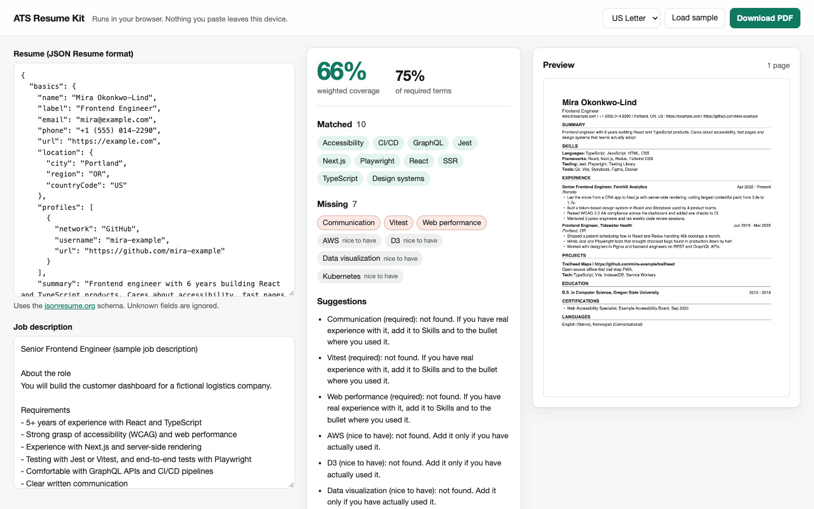
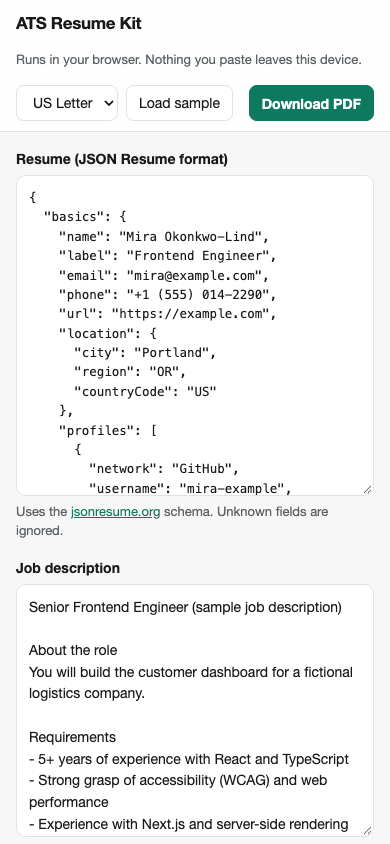

# ats-resume-kit

Turn a [JSON Resume](https://jsonresume.org/schema) into a clean, one-page PDF that applicant tracking systems can read, and check how well it covers a job description.

- **Library + CLI** (TypeScript): `renderResume()` and `matchResume()`, or `ats-resume render` / `ats-resume match`.
- **Keyword matcher**: pulls skills out of a job posting, splits them into required and nice-to-have, and shows coverage, matched and missing terms.
- **Honest suggestions**: it points at wording and placement only. It never tells you to add a skill your resume doesn't show.
- **Web page** (Vite + React): paste JSON and a job description, see the PDF and the report, download. **Everything runs in your browser. Nothing you paste is uploaded anywhere.**



| Dark mode | Phone | Generated PDF |
| --- | --- | --- |
|  |  |  |

The sample resume (`examples/resume.json`) and job (`examples/job.txt`) are fictional.

## Quick start

```bash
pnpm install
pnpm dev                 # web page at http://localhost:5173
pnpm test                # vitest
pnpm build               # library + CLI into dist/
```

### CLI

```bash
node dist/cli.js render examples/resume.json -o resume.pdf   # --a4, --no-fit
node dist/cli.js match examples/resume.json examples/job.txt  # --json, --min 70
```

```
Coverage: 66%  (required terms: 75%)

Matched (10): Accessibility, CI/CD, GraphQL, Jest, Next.js, Playwright, React, SSR, TypeScript, Design systems
Missing (7): Communication, Vitest, Web performance, AWS (nice to have), D3 (nice to have), ...

- Vitest (required): not found. If you have real experience with it, add it to Skills and to the bullet where you used it.
- AWS (nice to have): not found. Add it only if you have actually used it.
```

`--min <pct>` exits with code 1 below that coverage, so you can use it in a script.

### Library

```ts
import { parseResume, renderResume, matchResume } from "ats-resume-kit";

const resume = parseResume(jsonString);             // throws a readable error on bad input
const { pdf, pages, scale } = await renderResume(resume, { pageSize: "a4" });
const report = matchResume(resume, jobDescription, [{ name: "Remix" }]); // optional extra terms
// report.coverage, report.requiredCoverage, report.matched, report.missing, report.suggestions
```

`renderResume` works in Node and in the browser (it only depends on `pdf-lib`).

## The ATS rules this follows

ATS parsers extract plain text from your PDF and try to sort it into fields. Fancy layouts break that. The renderer sticks to what parses reliably:

| Rule | Why |
| --- | --- |
| **One column, top to bottom** | Two-column layouts are often read across both columns line by line, mixing your job titles with your skills. |
| **Real text, standard fonts** (Helvetica) | Text is selectable and copyable. No text in images, no outlined glyphs, no icon fonts. Characters the font can't encode become `?` instead of silently vanishing. |
| **Standard section headings** | `SUMMARY`, `SKILLS`, `EXPERIENCE`, `PROJECTS`, `EDUCATION`, `CERTIFICATIONS`, `LANGUAGES`. Parsers look for these exact words; "My Journey" or "Toolbox" get missed. |
| **No tables, images, headers or footers for content** | Many parsers skip tables and page headers/footers. Your name and contact details are the first lines of body text. The only graphics are thin rules under headings. |
| **Plain contact line** | Email, phone, city and links written out as text separated by `|`, so they can be found by pattern. |
| **Consistent dates** | `Mon YYYY - Mon YYYY` or `Present`, aligned on the same line as the role. |
| **One page** | Type scales down (to 80% at most) to fit. If it still doesn't fit, a second page is added and the CLI warns you to trim. |
| **Document metadata** | Title, author and language are set, which some systems show to recruiters. |

### How the matcher works

- A curated dictionary of about 100 software, web, data and team terms, each with aliases (`k8s` = Kubernetes, `ReactJS` = React). Matching respects symbols, so `C++`, `C#`, `Node.js` and `CI/CD` work and `Java` doesn't match `JavaScript`.
- Lines under headings like "Nice to have" or "Preferred", or lines that say "is a plus" or "bonus", make a term **nice to have**. Everything else is **required**.
- Coverage is weighted: required terms count double. The report also shows the share of required terms covered.
- When your resume uses a different spelling than the posting, it suggests using the posting's exact word. When a required skill is only in your Skills list, it suggests naming it in the bullet where you used it.
- Missing terms always come with the condition "only if you actually have this experience". The tool has no way to invent experience and won't pretend to.

Limits: it's a dictionary, not a language model, so domain-specific terms need `extraTerms`, and "Jest or Vitest" counts as two separate requirements.

## Privacy

The web page is a static site. Rendering and matching happen in your browser tab with no network requests for your data, no analytics and no storage. The CLI reads and writes local files only.

## License

[MIT](LICENSE)
